# Upadhyay Coaching Center – Student Portal

A full-stack MERN web app for a coaching center covering Nursery to Class 12. The public website
shows the center's classes and faculty, and a secure portal lets students, teachers and the admin
manage studies, marks and fees.

## Features
- **Public website:** home page, courses, faculty (loaded from the database), demo class enquiry form
- **Roles:** admin, teacher and student, each with their own dashboard
- **Study materials:** class-wise uploads by type (notes, test paper, homework...), sent to the whole class or to selected students
- **Student records:** contact details, school, parents, joining and leaving dates, former-student list
- **Marks:** school and coaching marks recorded per student
- **Fees:** default fee per class, custom fee per student, monthly payment records (cash or online)
- **Accounts:** created by the admin with a password the admin sets; users must change it at first login

## Tech stack
React (Vite), Node.js, Express, MongoDB (Mongoose), JWT, bcrypt, Multer

## Security
- Passwords hashed with bcrypt; JWT sessions that expire
- Role checks on the server for every protected route
- Login rate limiting, Helmet, CORS limited to the client URL, request size limits
- NoSQL-injection sanitizing and input validation
- Uploads limited by type and size; file downloads checked per class and per student
- Public API returns only the minimum data (faculty name and subjects)

## Getting started
You need Node.js 18+ and a MongoDB database (Atlas or local).

    cd server
    npm install
    cp .env.example .env      # on Windows: copy .env.example .env
    # edit .env: MONGO_URI, JWT_SECRET (a long random string), CLIENT_URL
    npm run seed              # creates a development admin account only
    npm run dev

    cd client
    npm install
    npm run dev

Development admin from the seed script: `admin@demo.com` / `Admin@12345`.
This is for local testing only. Never use it on a real deployment.

## Screenshots

### Home page

  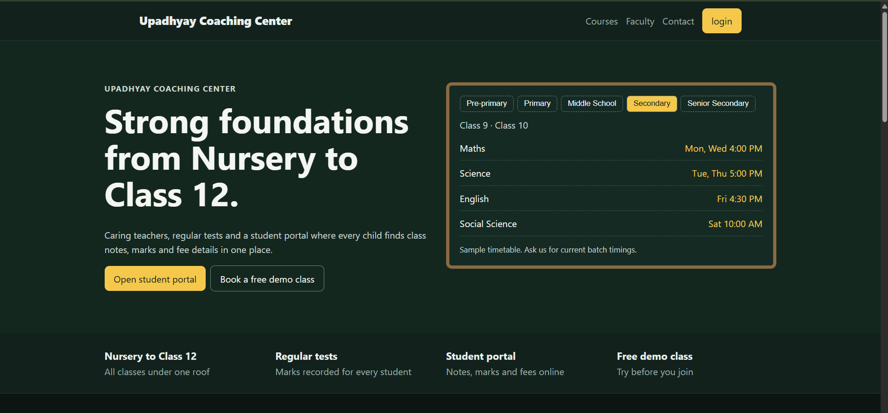
  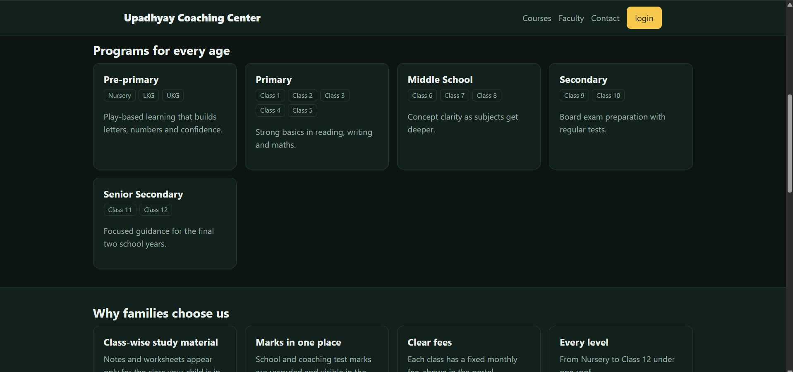
  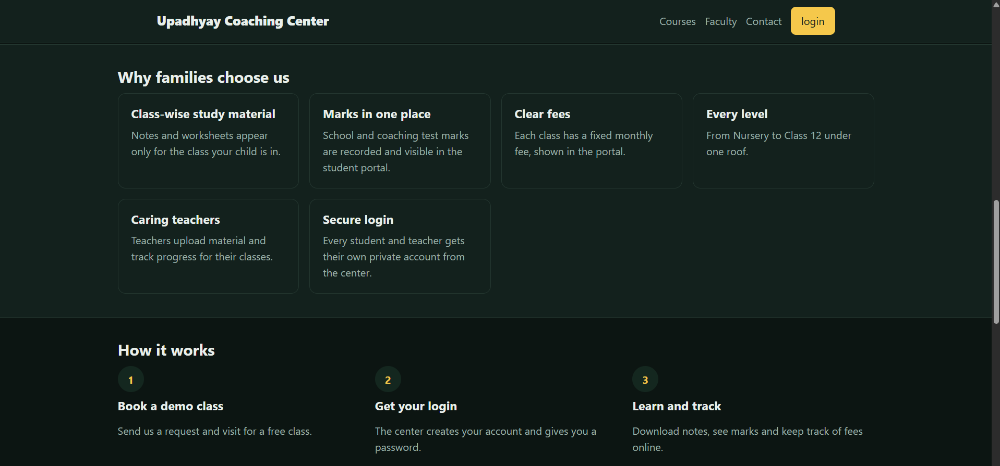
  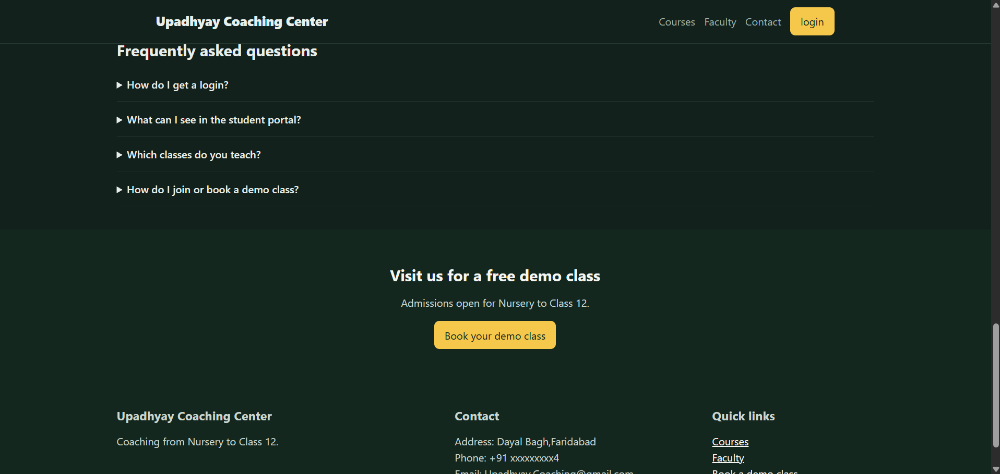

### Login page
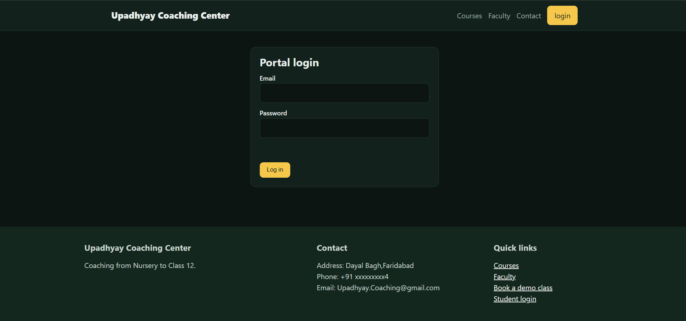

### Admin panel

  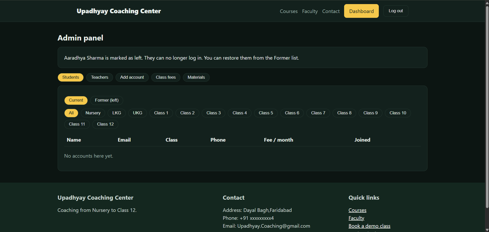
  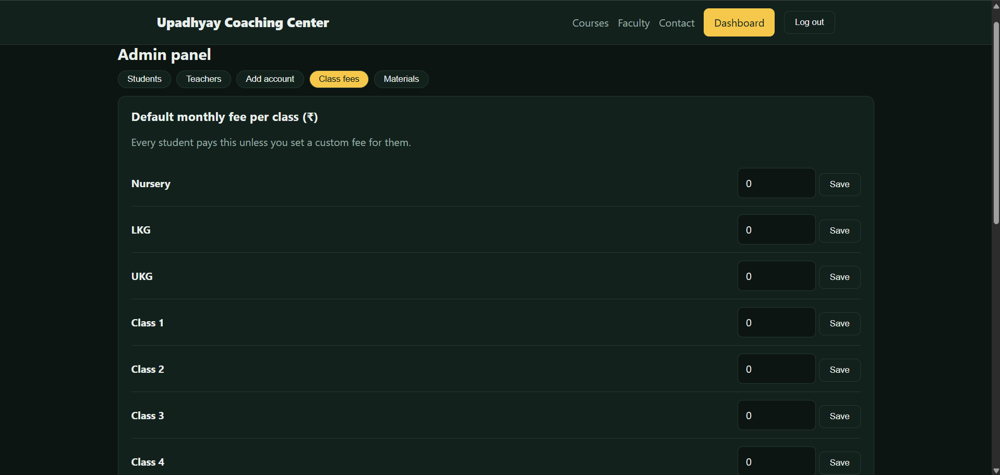
  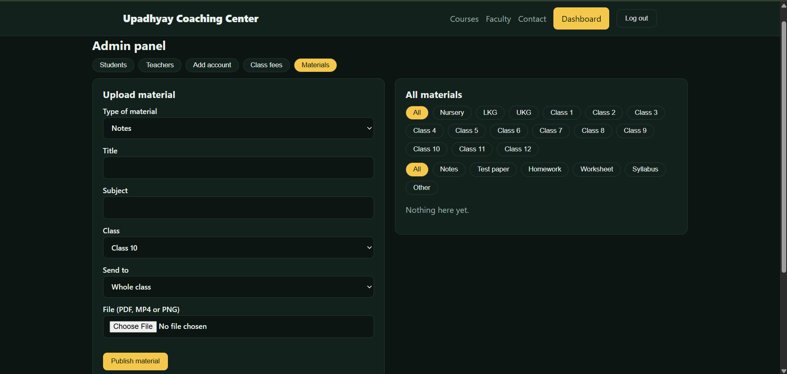
  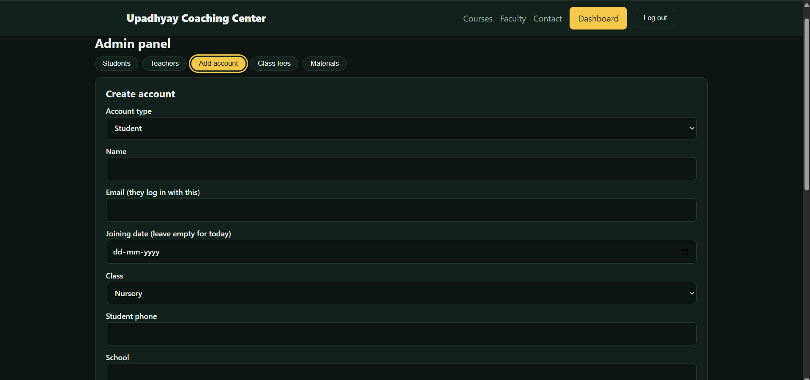
  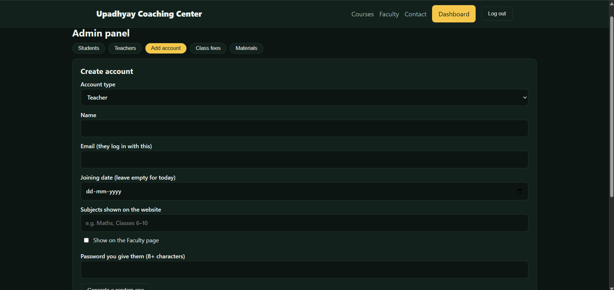

### Student dashboard
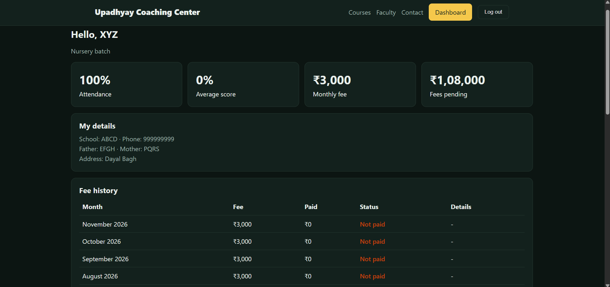

### Teacher dashboard
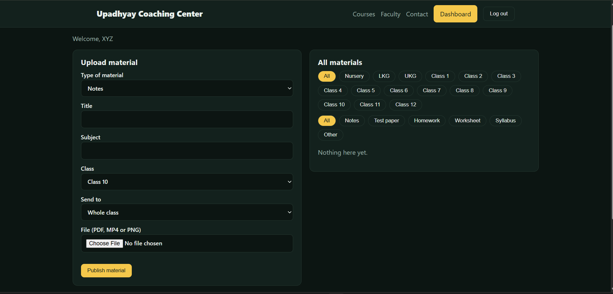

### Contact page
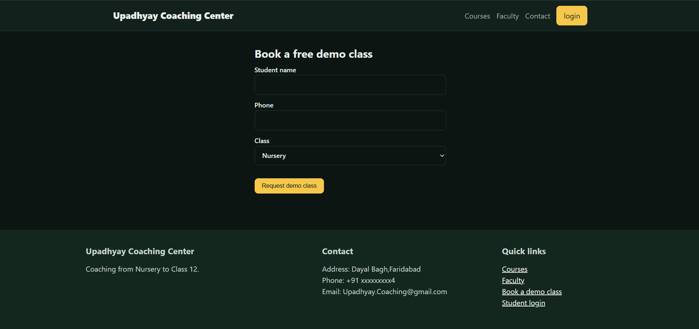

### Courses page
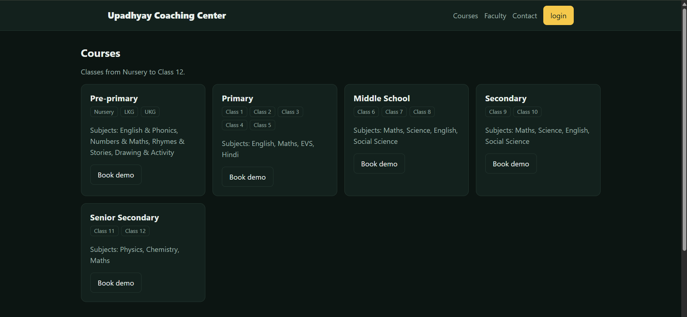

## Roadmap

**Done**
- [x] Admin, teacher and student roles with secure login
- [x] Class-wise study materials by type, sent to a class or to selected students
- [x] Student details, joining and leaving dates
- [x] School and coaching marks
- [x] Class fees, custom fees and monthly payment records (cash or online)
- [x] Faculty page loaded from the database

**Planned**
- [ ] Save "book a demo class" enquiries and show them to the admin
- [ ] Daily attendance marking by teachers
- [ ] Announcements for the whole center or one class
- [ ] Pending-fees report with CSV export and printable receipts
- [ ] Forgot-password by email and an admin audit log
- [ ] Automated tests and GitHub Actions
- [ ] Deployment (Cloudinary for files, Render, Vercel)

## Known limitations
- Uploaded files are stored on the server's disk (cloud storage planned for deployment)
- Fee amounts use the student's current fee for every month; past fee changes are not tracked
- Attendance is a stored number for now, not yet calculated from daily records
- The website's contact details and timetable are written in code, not editable from the admin panel